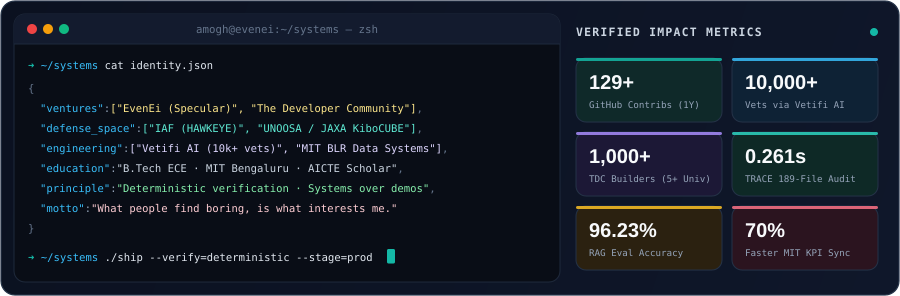
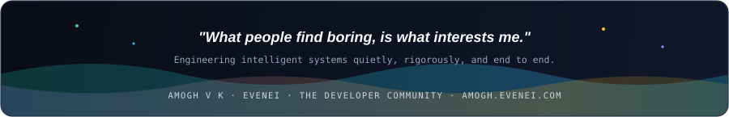

  

   

  

   

  
  
  
  
  
  
  
  

 

  

## 🧭 System Overview & Identity

  

 

<table>
  <tr>
    <td width="50%" valign="top">
      <h3>⚡ Engineering Thesis</h3>
      
My work lives where <strong>hardware, software, and machine intelligence</strong> operate as one cohesive system — never AI as a surface wrapper.

      <ul>
        <li><strong>Systems Over Demos:</strong> Full vertical slices with database RLS constraints, security boundaries, telemetry, and deterministic tests.</li>
        <li><strong>Constraint-Driven Design:</strong> Keeping Specular smart glasses under INR 20,000 via phone offload, or auditing 189 files on local CPU in 0.261s with zero tokens.</li>
        <li><strong>Deterministic Verification:</strong> Pairing AI reasoning with rigid-body Euler physics, replayable security oracles, and blind benchmarks.</li>
      </ul>
    </td>
    <td width="50%" valign="top">
      <h3>🛰️ Active Orbits &amp; Ventures</h3>
      <ul>
        <li>🏢 <strong>Founder @ <a href="https://www.evenei.com">EvenEi Private Limited</a></strong> — Building <a href="https://specular.evenei.com">Specular</a> AI smart glasses ($1K pre-product seed, Google for Startups / Antler Immersion) &amp; <a href="https://adspace.evenei.com">AdSpace</a>.</li>
        <li>🚀 <strong>Founder @ <a href="https://thedevcommunity.in">The Developer Community (TDC)</a></strong> — 1,000+ registrations across 5+ universities shipping verified production software.</li>
        <li>✈️ <strong>SWE &amp; AI Intern @ Indian Air Force</strong> — Engineering <strong>HAWKEYE</strong>, an automated 3 km runway FOD detection pipeline scheduled for <em>Aero India 2027</em>.</li>
        <li>🛰️ <strong>CubeSat ADCS Intern @ UNOOSA / JAXA KiboCUBE</strong> — 1U spacecraft magnetorquer hardware, I²C IMU integration, and C++/Python B-dot detumbling.</li>
      </ul>
    </td>
  </tr>
</table>

  

## 📈 Live Progress Telemetry & Mission Pipelines

> Auto-updated daily via GitHub Actions GraphQL — tracking live chronology, degree milestones, GitHub contribution goals, and active flagship build progress.

  

  

## 🚀 Flagship Systems Showcase

<table>
  <tr>
    <td width="50%" valign="top">
      <h3>🛡️ <a href="https://github.com/VK-Amogh/TRACE">TRACE</a> &nbsp; </h3>
      
Local-first neuro-symbolic security verification for AI coding agents (Claude Code, Cursor, Codex, Antigravity). Parses multi-language repos into an Attack-Path Model and proves every fix with a replay verification oracle.

      
<strong>Verified:</strong> <code>0.261s</code> 189-file offline audit · <code>100%</code> precision &amp; recall on testbed · <code>0</code> LLM tokens · <code>250+</code> passing tests

      
<code>Python</code> <code>Tree-sitter</code> <code>NetworkX</code> <code>MCP</code> <code>SecureBERT 2.0</code>

      
<a href="https://github.com/VK-Amogh/TRACE">Repository</a> · <a href="https://VK-Amogh.github.io/TRACE/">Docs</a> · <a href="https://trace.evenei.com">Case Study</a>

    </td>
    <td width="50%" valign="top">
      <h3>✈️ HAWKEYE · Indian Air Force &nbsp; </h3>
      
Automated runway foreign-object-debris (FOD) detection software fusing 76–81 GHz mmWave radar returns with visible and thermal optical feeds for all-weather airbase safety.

      
<strong>Verified:</strong> <code>3 km &lt; 4 min</code> sweep at <code>50 km/h</code> · <code>8</code> modalities (RGB, NIR, LWIR, SWIR, MWIR) · YOLOv5, R-CNN &amp; DETR + CSRT

      
<code>Python</code> <code>OpenCV</code> <code>YOLOv5</code> <code>DETR</code> <code>mmWave Radar</code>

      
<a href="https://amogh.evenei.com">Interactive Runway Fusion Console on Portfolio</a>

    </td>
  </tr>
  <tr>
    <td width="50%" valign="top">
      <h3>👓 <a href="https://specular.evenei.com">Specular (EvenEi)</a> &nbsp; </h3>
      
Always-available AI smart glasses and contextual memory companion designed across ESP32-S3 capture firmware, a Flutter companion app, and Firebase/Supabase orchestration.

      
<strong>Verified:</strong> <code>USD 1,000</code> pre-product seed · <code>&lt; INR 20K</code> BOM target via mobile ML offload · Antler Immersion

      
<code>ESP32-S3</code> <code>Flutter</code> <code>Dart</code> <code>Multimodal AI</code> <code>Supabase</code>

      
<a href="https://specular.evenei.com">Architecture Portal</a> · <a href="https://www.evenei.com">EvenEi Studio</a>

    </td>
    <td width="50%" valign="top">
      <h3>🩺 <a href="https://github.com/VK-Amogh/vetifi-ai-v3">Vetifi AI</a> &nbsp; </h3>
      
India's first veterinary clinical decision-support platform pairing disease-ontology knowledge graphs, symptom trees, and auditable BM25/vector retrieval with production Android &amp; iOS apps.

      
<strong>Verified:</strong> <code>10,000+</code> active veterinarians · <code>96.23%</code> RAG eval accuracy · <code>992</code> indexed manual chunks offline

      
<code>Python</code> <code>Agentic RAG</code> <code>Knowledge Graphs</code> <code>BM25</code> <code>Flutter</code>

      
<a href="https://github.com/VK-Amogh/vetifi-ai-v3">v3 Prototype</a> · <a href="https://vetifi.evenei.com">Case Study</a>

    </td>
  </tr>
  <tr>
    <td width="50%" valign="top">
      <h3>🛰️ <a href="https://github.com/VK-Amogh/IU-Cubesat-ICARUS-Rotational-Dynamics-Magnetorquer-Plant">ICARUS 1U CubeSat ADCS</a> &nbsp; </h3>
      
Rigid-body 3-axis rotational dynamics plant, magnetorquer torque mapper, and C++/Python B-dot detumbling verification suite built for the UNOOSA / JAXA KiboCUBE orbital challenge.

      
<strong>Verified:</strong> <code>10/10</code> physics verification tests · proven magnetic underactuation (<code>m × B</code>) · companion 7.4V <a href="https://github.com/VK-Amogh/Cubesat-Phase-2-EPS-">CubeSat EPS</a>

      
<code>Python</code> <code>C++</code> <code>NumPy</code> <code>I2C / MEMS IMU</code> <code>OrCAD X</code>

      
<a href="https://github.com/VK-Amogh/IU-Cubesat-ICARUS-Rotational-Dynamics-Magnetorquer-Plant">ADCS Plant</a> · <a href="https://github.com/VK-Amogh/Cubesat-Phase-2-EPS-">EPS Circuit</a> · <a href="https://icarus.evenei.com">Case Study</a>

    </td>
    <td width="50%" valign="top">
      <h3>🌐 <a href="https://thedevcommunity.in">The Developer Community (TDC)</a> &nbsp; </h3>
      
Student-to-industry engineering network where builders ship real production software with automated GitHub contribution tracking, live cohort dashboards, and verifiable proof of work.

      
<strong>Verified:</strong> <code>1,000+</code> registrations across <code>5+</code> universities · <code>20</code> Cohort 1 interns · shipped <strong>ONE-CREW</strong> &amp; <strong>STASH</strong>

      
<code>React Router 7 SSR</code> <code>TypeScript</code> <code>Supabase</code> <code>PostgreSQL</code>

      
<a href="https://thedevcommunity.in">Live Platform</a> · <a href="https://amogh.evenei.com">Full Story</a>

    </td>
  </tr>
</table>

  
<strong>📂 Expand Complete Archive — 12 More Shipped &amp; Verified Systems</strong>

   

| System | Domain | Verified Highlights | Stack | Links |
| :--- | :--- | :--- | :--- | :--- |
| **Your Space** | Mobile &amp; Flutter | 14-package Dart workspace, 31-tool GPU darkroom editor, 151 tests passing, 100% on-device | `Flutter` `Drift` `MediaStore` `Shaders` | [Site](https://yourspace-site-blush.vercel.app) · [Study](https://your-space.evenei.com) |
| **Saral AI** | Civic AI &amp; Mobile | 12-state FastAPI task machine, `FLAG_SECURE` OTP sheets, 5-point PDF verifier, INR 0/mo infra | `Flutter` `FastAPI` `Playwright` `Groq` | [Repo](https://github.com/VK-Amogh/Saral-Test) · [Study](https://saral.evenei.com) |
| **AdSpace** | Marketplace &amp; MCP | Turborepo monorepo + 10-service FastAPI agent protocol &amp; escrow settlement architecture | `Next.js` `Turborepo` `FastAPI` `MCP` | [Live](https://adspace.evenei.com) |
| **Stockie** | Retail POS &amp; Mobile | 14 normalized PostgreSQL tables, barcode-to-reorder &amp; 7/30/90-day sales-velocity forecasting | `Flutter` `PostgreSQL` `Firebase` `Node.js` | [Repo](https://github.com/VK-Amogh/Stockie) · [Study](https://stockie.evenei.com) |
| **SafeSpace** | Local Vision Security | `0 / 741` blind weapon false alarms, `1.7%` fight FAR, local GPU + Ollama Gemma 4 assistant | `YOLO26s` `DINOv2` `VideoMAE` `FastAPI` | [Repo](https://github.com/VK-Amogh/Live-Threat-Detection-System-and-NL-to-command-ruleset) · [Study](https://safespace.evenei.com) |
| **Agentic Honeypot** | Threat Intel &amp; NLP | Autonomous multi-turn scam persona extracting UPI IDs, bank details &amp; phishing IOCs (`6/6` tests) | `Python` `FastAPI` `Groq LLM` `Flutter` | [Repo](https://github.com/VK-Amogh/Agentic-Honey-Pot-for-Scam-Detection-Intelligence-Extraction) · [Study](https://honeypot.evenei.com) |
| **DroneController** | FPV &amp; WebGL | Unity C# physics for Radiomaster Pocket ELRS + playable Three.js WebGL simulator &amp; ESP32 hook | `Unity` `C#` `Three.js` `WebGL` `PID` | [Play Live](https://dronecontroller.evenei.com) · [Repo](https://github.com/VK-Amogh/DroneController) |
| **MIT KPI Portal** | Data Systems | Cut institutional KPI reporting time by `70%` with normalized Postgres &amp; Supabase RLS isolation | `React 19` `TypeScript` `Supabase RLS` | [Live Portal](https://manipal-records.evenei.com) |
| **CubeSat Phase 2 EPS** | Aerospace Hardware | 7.4V regulated orbital Li-ion bus across 6s sunlit / 3s eclipse verified in OrCAD X &amp; CircuitJS | `OrCAD X` `CircuitJS` `SPICE` `Python` | [Repo](https://github.com/VK-Amogh/Cubesat-Phase-2-EPS-) |
| **Driftinn** | Campus Social | Institutional `.edu` OTP auth, MBTI anti-profiles &amp; dark glassmorphic Flutter UI on Riverpod | `Flutter` `Dart` `Riverpod` `Firebase` | [Repo](https://github.com/VK-Amogh/Driftinn) · [Study](https://driftinn.evenei.com) |
| **Expensify** | FinTech · 1st Place | First Place HackSprint 2026 winning UPI QR scan-to-log expense tracker, splits &amp; daily limits | `Flutter` `Dart` `Supabase` `UPI` | [Study](https://expensify.evenei.com) |
| **SquashDeck** | Workflow Marketplace | Sole-engineered 2-sided QA marketplace with 7-state transition guards &amp; sub-second Realtime sync | `React` `Node.js` `Supabase` `Postgres` | [Repo](https://github.com/VK-Amogh/Squash-Deck) |

  

## 💼 Experience & Ventures Timeline

| Organization | Role | Period | Domain | Key Verified Impact |
| :--- | :--- | :--- | :--- | :--- |
| **Indian Air Force (HAWKEYE)** | SWE &amp; AI Intern | `Apr 2025 – Present` | `Defense & CV` | Automated 3 km runway FOD scan in `< 4 min` at 50 km/h fusing 76–81 GHz radar + 8 camera modalities (Aero India 2027) |
| **The Developer Community** | Founder &amp; Lead Engineer | `Apr 2025 – Present` | `Venture` | Scaled to `1,000+` registrations across `5+` universities; built React Router 7 SSR platform, ONE-CREW &amp; STASH |
| **Vetifi Technologies** | AI/ML &amp; Flutter Intern | `Mar 2025 – Present` | `Applied AI` | Helped scale clinical platform to `10,000+` vets; `96.23%` RAG eval accuracy &amp; clinical knowledge graph |
| **MIT Bengaluru** | Software Dev Intern | `Jan 2025 – Present` | `Data Systems` | Cut KPI reporting cycle by `70%` with React 19 + normalized PostgreSQL &amp; Supabase Row-Level Security |
| **UNOOSA / JAXA KiboCUBE** | CubeSat ADCS Intern | `Aug 2024 – Present` | `Aerospace` | Designed 1U CubeSat magnetorquer subsystem, I²C MEMS IMU integration, C++/Python B-dot control &amp; 7.4V EPS |
| **EvenEi Pvt. Ltd. (Specular)** | Founder &amp; Engineer | `Jul 2024 – Present` | `AI Hardware` | Raised `USD 1,000` early seed &amp; accepted to Google for Startups / Antler Immersion; sub-INR 20K smart-glasses stack |

  

## 🛠️ Tech Stack Matrix & Language Telemetry

  

 

  

 

| Layer | Core Stack &amp; Tooling |
| :--- | :--- |
| **Languages** | `Python` · `Dart` · `TypeScript` · `JavaScript` · `C++` · `C` · `SQL (PL/pgSQL)` · `Java` · `C#` |
| **Mobile &amp; Frontend** | `Flutter` · `Riverpod` · `Drift SQLite` · `React 19` · `React Router 7 SSR` · `Next.js` · `Tailwind CSS` · `Three.js / WebGL` |
| **AI, Vision &amp; Agents** | `Agentic RAG` · `BM25 / Qdrant / Pinecone` · `Knowledge Graphs` · `MCP` · `YOLOv5 / v8 / 26s` · `DETR` · `DINOv2` · `OpenCV` · `PyTorch` · `TensorFlow` |
| **Backend, Cloud &amp; Security** | `FastAPI` · `Node.js` · `PostgreSQL` · `Supabase RLS` · `Firebase` · `Google Cloud / Vertex AI` · `Tree-sitter AST` · `Playwright` |
| **Embedded &amp; Aerospace** | `ESP32-S3` · `CubeSat ADCS & B-Dot` · `I²C / MEMS IMU` · `76–81 GHz mmWave Radar` · `OrCAD X` · `CircuitJS` · `Unity Flight Physics` |

  

## 🏆 Published Security Research & Recognition

<table>
  <tr>
    <td width="50%" valign="top">
      <h3>🔐 Published Security Research</h3>
      
<strong><a href="https://infosecwriteups.com/i-hacked-into-my-universitys-vending-machine-and-it-was-soo-bad-c411c2b968f4">JustVend Android Application &amp; Backend Security Assessment</a></strong> 
      <em>InfoSec Write-ups (Medium) · Responsible Disclosure · Sept 2026</em>

      <ul>
        <li>Audited campus vending Android client and Razorpay dispatch flow (<code>myorder.php</code>) to verify backend trust boundaries.</li>
        <li>Identified hardcoded production DB credentials &amp; exposed <code>/phpmyadmin</code> endpoints shipped in client code.</li>
        <li>Published architectural lessons responsibly while withholding APKs, secrets, and exploit chains.</li>
      </ul>
    </td>
    <td width="50%" valign="top">
      <h3>🎖️ Honors &amp; Selections</h3>
      <ul>
        <li>🥇 <strong>1st Place, HackSprint 2026</strong> — Ignite, MIT Bengaluru (<em>Expensify</em>) + <strong>5+ Hackathon Wins</strong></li>
        <li>🌟 <strong>Google Campus &amp; Gemini Student Ambassador (2026)</strong></li>
        <li>⚡ <strong>Google Build with AI: App Roadshows</strong> — Top 2% (1 of 100 selected from 5,000+ applicants at Google Ananta)</li>
        <li>🚀 <strong>Google for Startups / Antler Immersion</strong> — EvenEi (Specular) + USD 1,000 seed funding</li>
        <li>🛰️ <strong>UNOOSA / JAXA KiboCUBE Selection</strong> — Global 1U orbital deployment programme</li>
        <li>🎓 <strong>AICTE National Merit Scholarship</strong> — B.Tech ECE, MIT Bengaluru (2024–2028)</li>
      </ul>
    </td>
  </tr>
</table>

  

## 📊 Live GitHub Telemetry & Contribution Snake

  <picture>
    <source media="(prefers-color-scheme: dark)" srcset="./assets/snake-dark.svg" />
    <source media="(prefers-color-scheme: light)" srcset="./assets/snake-light.svg" />
    
  </picture>

 

  
  

 

  

 

  

