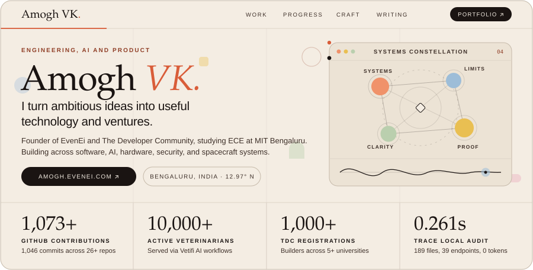
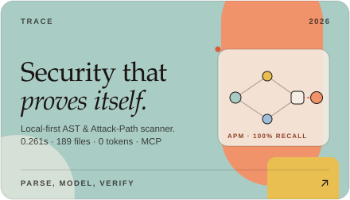
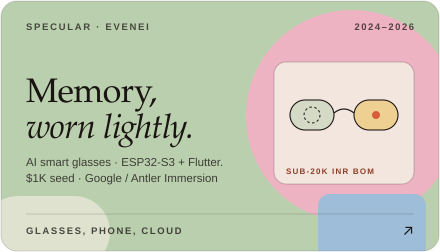
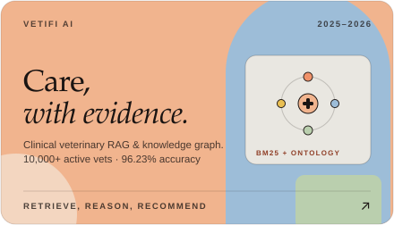
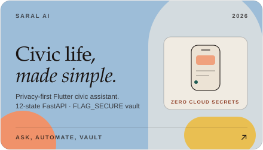
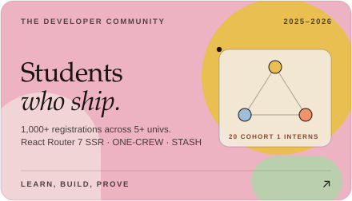
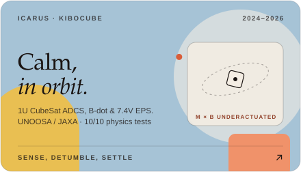
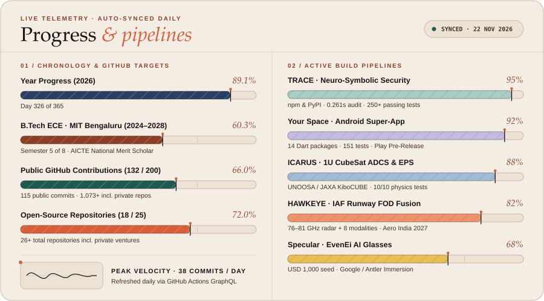
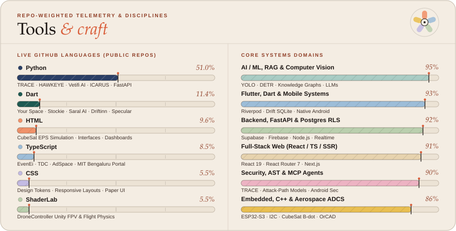
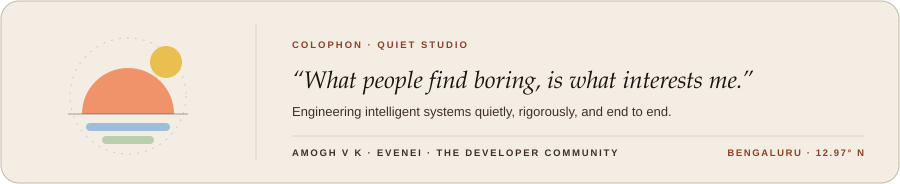

  

   

  
  
  
  
  
  
  

 

  

### Selected *work*
From live deployments to working prototypes and spacecraft simulations — click any poster to inspect the repository or live study.

 

  
  
   
  
  
   
  
  

 

  
<strong>Complete archive — 13 more shipped systems, prototypes &amp; studies</strong>

   

| Project | Domain | Stage &amp; Verified Evidence | Stack | Links |
| :--- | :--- | :--- | :--- | :--- |
| **HAWKEYE** | Defense &amp; CV | Indian Air Force contract · 3 km FOD sweep `< 4 min` at 50 km/h · 76–81 GHz radar + 8 modalities · *Aero India 2027* | `Python` `YOLOv5` `DETR` `CSRT` `mmWave` | [Portfolio Lab](https://amogh.evenei.com) |
| **Your Space** | Mobile &amp; Flutter | 14-package Dart workspace · 31-tool GPU darkroom editor · 151 tests passing · 100% on-device | `Flutter` `Drift` `MediaStore` `Shaders` | [Site](https://yourspace-site-blush.vercel.app) · [Study](https://your-space.evenei.com) |
| **EvenEi** | Venture Studio | 14-route SSR company platform unifying Specular &amp; AdSpace | `React Router 7` `TypeScript` `Supabase` | [Live](https://www.evenei.com) · [Repo](https://github.com/VK-Amogh/Evenei-web) |
| **AdSpace** | Marketplace &amp; MCP | Turborepo monorepo + 10-service FastAPI agent protocol &amp; escrow settlement | `Next.js` `Turborepo` `FastAPI` `MCP` | [Live](https://adspace.evenei.com) |
| **Stockie** | Retail POS &amp; Mobile | 14 normalized PostgreSQL tables · barcode-to-reorder &amp; 7/30/90-day velocity forecasting | `Flutter` `PostgreSQL` `Firebase` `Node.js` | [Repo](https://github.com/VK-Amogh/Stockie) · [Study](https://stockie.evenei.com) |
| **CubeSat Phase 2 EPS** | Aerospace Hardware | 7.4V regulated Li-ion orbital bus across 6s sunlit / 3s eclipse verified in OrCAD X &amp; CircuitJS | `OrCAD X` `CircuitJS` `SPICE` `Python` | [Repo](https://github.com/VK-Amogh/Cubesat-Phase-2-EPS-) |
| **DroneController** | FPV &amp; WebGL | Unity C# physics for Radiomaster Pocket ELRS + playable Three.js WebGL edition &amp; ESP32 hook | `Unity` `C#` `Three.js` `WebGL` `PID` | [Play Live](https://dronecontroller.evenei.com) · [Repo](https://github.com/VK-Amogh/DroneController) |
| **MIT KPI Portal** | Data Systems | Cut institutional KPI reporting cycle by `70%` with normalized Postgres &amp; Supabase RLS | `React 19` `TypeScript` `Supabase RLS` | [Live Portal](https://manipal-records.evenei.com) |
| **SafeSpace** | Local Vision Security | `0 / 741` blind weapon false alarms · `1.7%` fight FAR · local PC GPU + Ollama Gemma 4 | `YOLO26s` `DINOv2` `VideoMAE` `FastAPI` | [Repo](https://github.com/VK-Amogh/Live-Threat-Detection-System-and-NL-to-command-ruleset) · [Study](https://safespace.evenei.com) |
| **Agentic Honeypot** | Threat Intel &amp; NLP | Multi-turn scam persona extracting UPI IDs, bank details &amp; phishing IOCs (`6/6` tests) | `Python` `FastAPI` `Groq LLM` `Flutter` | [Repo](https://github.com/VK-Amogh/Agentic-Honey-Pot-for-Scam-Detection-Intelligence-Extraction) · [Study](https://honeypot.evenei.com) |
| **Driftinn** | Campus Social | Institutional `.edu` OTP auth, MBTI anti-profiles &amp; reusable glass Flutter UI on Riverpod | `Flutter` `Dart` `Riverpod` `Firebase` | [Repo](https://github.com/VK-Amogh/Driftinn) · [Study](https://driftinn.evenei.com) |
| **Expensify** | FinTech · 1st Place | First Place HackSprint 2026 winning UPI QR scan-to-log tracker, splits &amp; budget caps | `Flutter` `Dart` `Supabase` `UPI` | [Study](https://expensify.evenei.com) |
| **SquashDeck** | QA Marketplace | Sole-engineered 2-sided QA marketplace · 7-state transition guards &amp; sub-second Realtime sync | `React` `Node.js` `Supabase` `Postgres` | [Repo](https://github.com/VK-Amogh/Squash-Deck) |

 

  

### Progress *&amp; pipelines*
Architectural ledger auto-synced daily via GitHub Actions GraphQL — tracking live chronology, degree milestones, open-source targets, and flagship builds.

 

  

 

  

### Tools *&amp; craft*
Live repo-weighted language telemetry paired with core systems disciplines.

 

  

 

| Discipline | Primary Stack |
| :--- | :--- |
| **Languages** | `Python` · `Dart` · `TypeScript` · `JavaScript` · `C++` · `C` · `SQL (PL/pgSQL)` · `Java` · `C#` |
| **Mobile &amp; Interfaces** | `Flutter` · `Riverpod` · `Drift SQLite` · `React 19` · `React Router 7 SSR` · `Next.js` · `Tailwind CSS` · `Three.js` |
| **AI, Vision &amp; Agents** | `Agentic RAG` · `BM25 / Qdrant / Pinecone` · `Knowledge Graphs` · `MCP` · `YOLOv5 / v8 / 26s` · `DETR` · `DINOv2` · `OpenCV` |
| **Backend, Cloud &amp; Security** | `FastAPI` · `Node.js` · `PostgreSQL` · `Supabase RLS` · `Firebase` · `Google Cloud / Vertex AI` · `Tree-sitter AST` · `Playwright` |
| **Embedded &amp; Aerospace** | `ESP32-S3` · `CubeSat ADCS & B-Dot` · `I²C / MEMS IMU` · `76–81 GHz mmWave Radar` · `OrCAD X` · `CircuitJS` · `Unity` |

 

  

### Experience, *writing &amp; recognition*

| Organization | Role | Period | Verified Impact |
| :--- | :--- | :--- | :--- |
| **Indian Air Force (HAWKEYE)** | SWE &amp; AI Intern | `Apr 2025 – Present` | Automated 3 km runway FOD scan in `< 4 min` at 50 km/h fusing 76–81 GHz radar + 8 camera modalities (*Aero India 2027*) |
| **The Developer Community** | Founder &amp; Lead Engineer | `Apr 2025 – Present` | Scaled to `1,000+` registrations across `5+` universities; built React Router 7 SSR platform, **ONE-CREW** &amp; **STASH** |
| **Vetifi Technologies** | AI/ML &amp; Flutter Intern | `Mar 2025 – Present` | Helped scale veterinary clinical AI to `10,000+` professionals; `96.23%` RAG eval accuracy &amp; structured knowledge graph |
| **MIT Bengaluru** | Software Dev Intern | `Jan 2025 – Present` | Reduced institutional KPI reporting time by `70%` via React 19, normalized PostgreSQL &amp; Supabase Row-Level Security |
| **UNOOSA / JAXA KiboCUBE** | CubeSat ADCS Intern | `Aug 2024 – Present` | Designed 1U magnetorquer subsystem, I²C MEMS IMU integration, C++/Python B-dot control &amp; 7.4V orbital EPS model |
| **EvenEi Pvt. Ltd. (Specular)** | Founder &amp; Engineer | `Jul 2024 – Present` | Secured `USD 1,000` pre-product seed &amp; Google for Startups / Antler Immersion; sub-INR 20K smart-glasses architecture |

 

<table>
  <tr>
    <td width="50%" valign="top">
      <h4>Published Security Research</h4>
      
<strong><a href="https://infosecwriteups.com/i-hacked-into-my-universitys-vending-machine-and-it-was-soo-bad-c411c2b968f4">JustVend Android Application &amp; Backend Security Assessment</a></strong> 
      <em>InfoSec Write-ups (Medium) · Responsible Disclosure · September 2026</em>

      <ul>
        <li>Mapped cart, Razorpay verification, and server-side dispatch (<code>myorder.php</code>) to audit backend trust boundaries.</li>
        <li>Identified hardcoded production DB credentials and exposed <code>/phpmyadmin</code> references shipped in client code.</li>
        <li>Published architectural lessons responsibly while withholding APKs, secrets, and exploit instructions.</li>
      </ul>
    </td>
    <td width="50%" valign="top">
      <h4>Recognition &amp; Selections</h4>
      <ul>
        <li><strong>First Place, HackSprint 2026</strong> — MIT Bengaluru (<em>Expensify</em>) + <strong>5+ Hackathon Wins</strong></li>
        <li><strong>Google Campus &amp; Gemini Student Ambassador</strong> — Selected 2026</li>
        <li><strong>Google Build with AI: App Roadshows</strong> — Top 2% (1 of 100 from 5,000+ applicants, Google Ananta)</li>
        <li><strong>Google for Startups / Antler Immersion</strong> — EvenEi (Specular) + USD 1,000 seed</li>
        <li><strong>UNOOSA / JAXA KiboCUBE</strong> — Global 1U CubeSat orbital deployment selection</li>
        <li><strong>AICTE National Merit Scholarship</strong> — B.Tech ECE, MIT Bengaluru (2024–2028)</li>
      </ul>
    </td>
  </tr>
</table>

 

  

### GitHub *activity*

  

 

  
  

 

  

 

  

