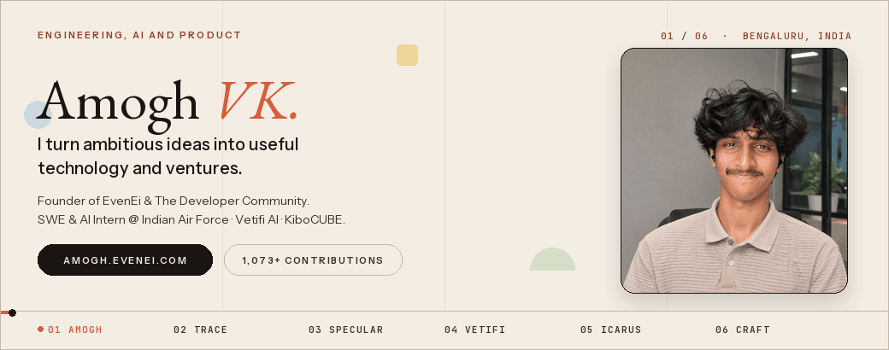
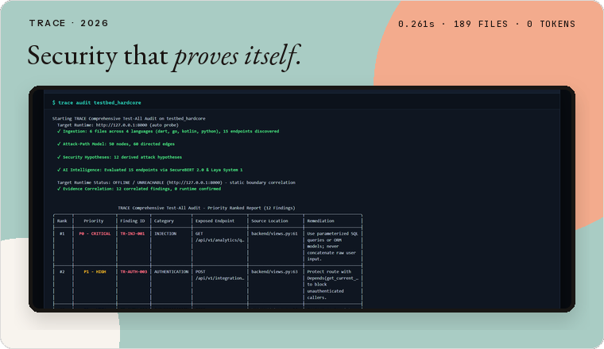
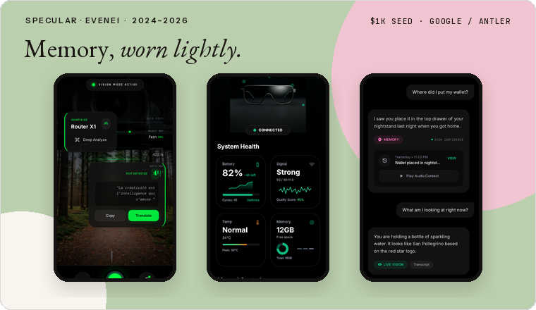
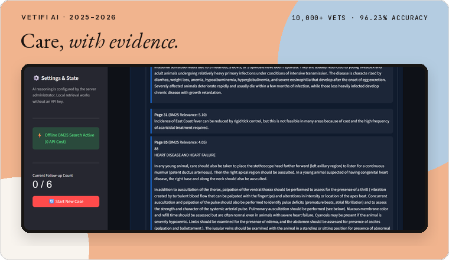
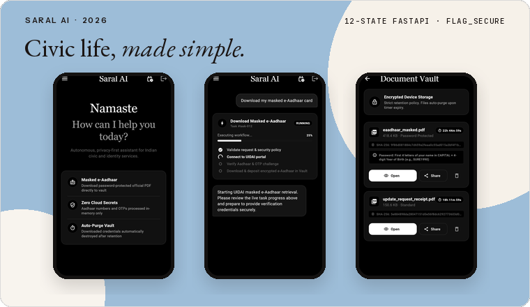
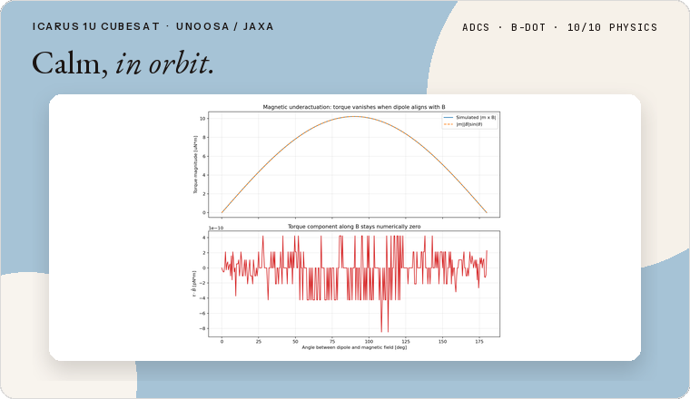
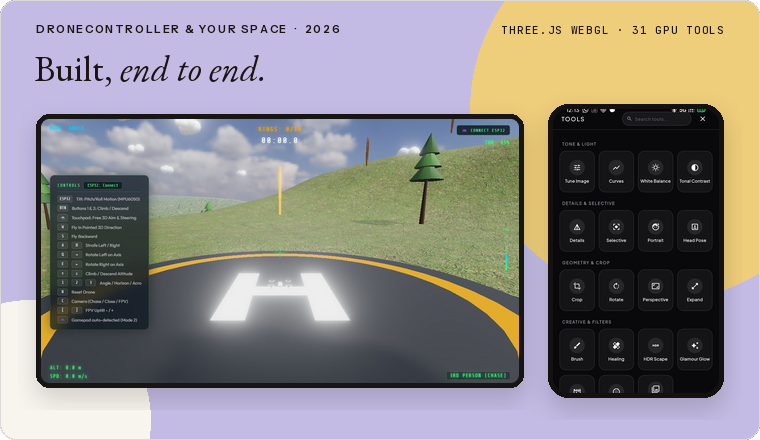
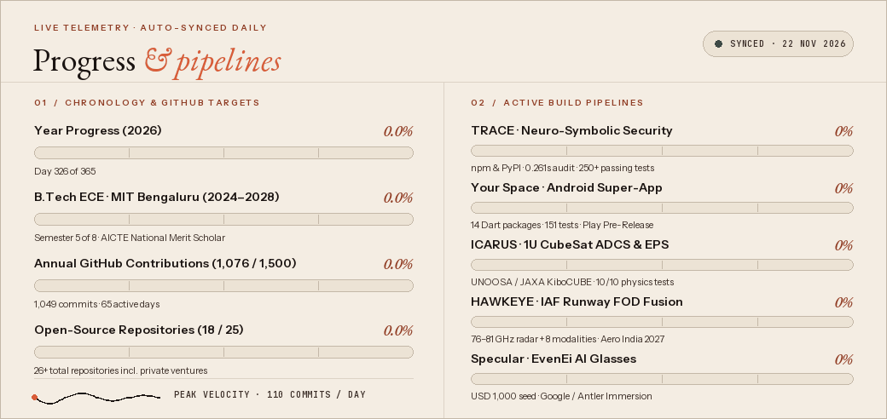
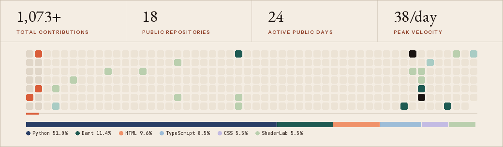

<div align="center">
  <a href="https://amogh.evenei.com" target="_blank">
    
  </a>
</div>

<br/>

<div align="center">
  <h2>Amogh V K</h2>
  <p>
    <strong>Founder</strong> of <a href="https://www.evenei.com">EvenEi</a> &amp; <a href="https://thedevcommunity.in">The Developer Community</a>
    &nbsp;&middot;&nbsp;
    <strong>SWE &amp; AI Intern</strong> @ Indian Air Force &amp; Vetifi AI
    &nbsp;&middot;&nbsp;
    <strong>CubeSat ADCS</strong> @ UNOOSA / JAXA KiboCUBE
  </p>
  <p>
    <a href="https://amogh.evenei.com"><strong>amogh.evenei.com</strong></a>
    &nbsp;&nbsp;&middot;&nbsp;&nbsp;
    <a href="https://www.linkedin.com/in/vk-amogh/">LinkedIn</a>
    &nbsp;&nbsp;&middot;&nbsp;&nbsp;
    <a href="https://www.evenei.com">EvenEi</a>
    &nbsp;&nbsp;&middot;&nbsp;&nbsp;
    <a href="https://thedevcommunity.in">TDC</a>
    &nbsp;&nbsp;&middot;&nbsp;&nbsp;
    <a href="https://medium.com/@amogh.vk.2005">Medium</a>
    &nbsp;&nbsp;&middot;&nbsp;&nbsp;
    <a href="https://leetcode.com/u/vkamogh/">LeetCode</a>
    &nbsp;&nbsp;&middot;&nbsp;&nbsp;
    <a href="mailto:amogh.vk.2005@gmail.com">Email</a>
  </p>
</div>

<br/>

| `1,073+` | `10,000+` | `1,000+` | `0.261s` |
| :---: | :---: | :---: | :---: |
| **GitHub Contributions**<br/><sub>1,046 commits across 26+ repos</sub> | **Active Veterinarians**<br/><sub>Served via Vetifi AI clinical flows</sub> | **TDC Registrations**<br/><sub>Student builders across 5+ univs</sub> | **TRACE Local Audit**<br/><sub>189 files, 39 endpoints, 0 tokens</sub> |

> *"What people find boring, is what interests me."* — Building complete systems where hardware, software, and machine intelligence operate as one cohesive, deterministically verified architecture.

---

### Selected *work*
<sub>Real captures from shipped platforms, mobile apps, security tools, and aerospace simulations — click any plate to open the repository or live study.</sub>

<br/>

<div align="center">
  <a href="https://github.com/VK-Amogh/TRACE" target="_blank"></a>
  <a href="https://specular.evenei.com" target="_blank"></a>
  <br/>
  <a href="https://github.com/VK-Amogh/vetifi-ai-v3" target="_blank"></a>
  <a href="https://github.com/VK-Amogh/Saral-Test" target="_blank"></a>
  <br/>
  <a href="https://github.com/VK-Amogh/IU-Cubesat-ICARUS-Rotational-Dynamics-Magnetorquer-Plant" target="_blank"></a>
  <a href="https://dronecontroller.evenei.com" target="_blank"></a>
</div>

<br/>

<details>
  <summary><strong>Complete archive &mdash; 13 more shipped systems, prototypes &amp; studies</strong></summary>
  <br/>

| System | Domain | Stage &amp; Verified Evidence | Primary Stack | Links |
| :--- | :--- | :--- | :--- | :--- |
| **HAWKEYE** | Defense &amp; CV | Indian Air Force contract · 3 km FOD sweep `< 4 min` at 50 km/h · 76–81 GHz radar + 8 modalities · *Aero India 2027* | <kbd>Python</kbd> <kbd>YOLOv5</kbd> <kbd>DETR</kbd> <kbd>mmWave</kbd> | [Portfolio Lab](https://amogh.evenei.com) |
| **The Developer Community** | Venture &amp; Web | Live platform · `1,000+` registrations across `5+` univs · shipped **ONE-CREW** &amp; **STASH** | <kbd>React Router 7</kbd> <kbd>TypeScript</kbd> <kbd>Supabase</kbd> | [thedevcommunity.in](https://thedevcommunity.in) |
| **Your Space** | Mobile &amp; Flutter | 14-package Dart workspace · 31-tool GPU darkroom · 151 passing tests · 100% on-device | <kbd>Flutter</kbd> <kbd>Drift</kbd> <kbd>MediaStore</kbd> <kbd>Shaders</kbd> | [Site](https://yourspace-site-blush.vercel.app) · [Study](https://your-space.evenei.com) |
| **EvenEi** | Venture Studio | 14-route SSR company headquarters unifying Specular &amp; AdSpace | <kbd>React Router 7</kbd> <kbd>TypeScript</kbd> <kbd>Supabase</kbd> | [evenei.com](https://www.evenei.com) · [Repo](https://github.com/VK-Amogh/Evenei-web) |
| **AdSpace** | Marketplace &amp; MCP | Turborepo monorepo + 10-service FastAPI agent protocol &amp; escrow settlement | <kbd>Next.js</kbd> <kbd>Turborepo</kbd> <kbd>FastAPI</kbd> <kbd>MCP</kbd> | [adspace.evenei.com](https://adspace.evenei.com) |
| **Stockie** | Retail POS &amp; Mobile | 14 normalized PostgreSQL tables · barcode-to-reorder &amp; 7/30/90-day velocity forecasting | <kbd>Flutter</kbd> <kbd>PostgreSQL</kbd> <kbd>Firebase</kbd> | [Repo](https://github.com/VK-Amogh/Stockie) · [Study](https://stockie.evenei.com) |
| **CubeSat Phase 2 EPS** | Aerospace Hardware | 7.4V regulated Li-ion bus across 6s sunlit / 3s eclipse verified in OrCAD X &amp; CircuitJS | <kbd>OrCAD X</kbd> <kbd>CircuitJS</kbd> <kbd>SPICE</kbd> <kbd>Python</kbd> | [Repo](https://github.com/VK-Amogh/Cubesat-Phase-2-EPS-) |
| **MIT KPI Portal** | Data Systems | Cut institutional KPI reporting cycle by `70%` via normalized Postgres &amp; Supabase RLS | <kbd>React 19</kbd> <kbd>TypeScript</kbd> <kbd>Supabase RLS</kbd> | [Portal](https://manipal-records.evenei.com) |
| **SafeSpace** | Local Vision Security | `0 / 741` blind weapon false alarms · `1.7%` fight FAR · local GPU + Ollama Gemma 4 | <kbd>YOLO26s</kbd> <kbd>DINOv2</kbd> <kbd>VideoMAE</kbd> <kbd>FastAPI</kbd> | [Repo](https://github.com/VK-Amogh/Live-Threat-Detection-System-and-NL-to-command-ruleset) · [Study](https://safespace.evenei.com) |
| **Agentic Honeypot** | Threat Intel &amp; NLP | Multi-turn scam persona extracting UPI IDs, bank details &amp; phishing IOCs (`6/6` tests) | <kbd>Python</kbd> <kbd>FastAPI</kbd> <kbd>Groq LLM</kbd> <kbd>Flutter</kbd> | [Repo](https://github.com/VK-Amogh/Agentic-Honey-Pot-for-Scam-Detection-Intelligence-Extraction) · [Study](https://honeypot.evenei.com) |
| **Driftinn** | Campus Social | Institutional `.edu` OTP auth, MBTI anti-profiles &amp; glassmorphic Flutter UI on Riverpod | <kbd>Flutter</kbd> <kbd>Dart</kbd> <kbd>Riverpod</kbd> <kbd>Firebase</kbd> | [Repo](https://github.com/VK-Amogh/Driftinn) · [Study](https://driftinn.evenei.com) |
| **Expensify** | FinTech · 1st Place | First Place HackSprint 2026 winning UPI QR scan-to-log tracker, bill splits &amp; limits | <kbd>Flutter</kbd> <kbd>Dart</kbd> <kbd>Supabase</kbd> <kbd>UPI</kbd> | [Study](https://expensify.evenei.com) |
| **SquashDeck** | QA Marketplace | Sole-engineered 2-sided QA marketplace · 7-state server guards &amp; sub-second Realtime | <kbd>React</kbd> <kbd>Node.js</kbd> <kbd>Supabase</kbd> <kbd>Postgres</kbd> | [Repo](https://github.com/VK-Amogh/Squash-Deck) |

</details>

---

### Progress *&amp; pipelines*
<sub>Animated daily-synced progress instrument + plain-text telemetry ledger updated via GitHub Actions GraphQL.</sub>

<br/>

<div align="center">
  
</div>

<br/>

<!-- TELEMETRY:START -->
```text
LIVE TELEMETRY  ·  SYNCED 2026-11-22 UTC  ·  BENGALURU, IN (12.97° N)
──────────────────────────────────────────────────────────────────────────
YEAR 2026      [████████████████████░░]   89.1%   Day 326 / 365
B.TECH ECE     [█████████████░░░░░░░░░]   60.3%   Sem 5 / 8 · MIT Bengaluru
CONTRIBUTIONS  [████████████████░░░░░░]   71.5%   1,073+ total across 26 repos
OPEN SOURCE    [████████████████░░░░░░]   72.0%   18 / 25 public repositories

REPO-WEIGHTED LANGUAGES
Python         [███████████░░░░░░░░░░░]   51.0%
Dart           [███░░░░░░░░░░░░░░░░░░░]   11.4%
HTML           [██░░░░░░░░░░░░░░░░░░░░]    9.6%
TypeScript     [██░░░░░░░░░░░░░░░░░░░░]    8.5%
CSS            [█░░░░░░░░░░░░░░░░░░░░░]    5.5%
```
<!-- TELEMETRY:END -->

---

### Systems *architecture &amp; craft*

```text
  PHYSICAL / EDGE                    CLIENT / INTERFACE                 INTELLIGENCE & VERIFICATION
  ─────────────────────────          ─────────────────────────          ─────────────────────────────
  ESP32-S3 · I²C MEMS IMU    ──▶     Flutter · Riverpod · Drift   ──▶   Agentic RAG · Knowledge Graphs
  76–81 GHz mmWave Radar     ──▶     React 19 · Router 7 SSR      ──▶   YOLOv5 / 26s · DETR · DINOv2
  1U CubeSat ADCS & EPS      ──▶     Next.js · Three.js WebGL     ──▶   Tree-sitter AST · MCP · Replay
  OrCAD X · CircuitJS        ──▶     PostgreSQL · Supabase RLS    ──▶   Euler Rigid-Body · B-Dot Math
```

| Layer | Core Stack |
| :--- | :--- |
| **Languages** | <kbd>Python</kbd> <kbd>Dart</kbd> <kbd>TypeScript</kbd> <kbd>JavaScript</kbd> <kbd>C++</kbd> <kbd>C</kbd> <kbd>SQL</kbd> <kbd>Java</kbd> <kbd>C#</kbd> |
| **Mobile &amp; Web** | <kbd>Flutter</kbd> <kbd>Riverpod</kbd> <kbd>Drift SQLite</kbd> <kbd>React 19</kbd> <kbd>React Router 7 SSR</kbd> <kbd>Next.js</kbd> <kbd>Tailwind CSS</kbd> <kbd>Three.js</kbd> |
| **AI &amp; Vision** | <kbd>Agentic RAG</kbd> <kbd>BM25</kbd> <kbd>Knowledge Graphs</kbd> <kbd>MCP</kbd> <kbd>YOLOv5 / v8 / 26s</kbd> <kbd>DETR</kbd> <kbd>DINOv2</kbd> <kbd>OpenCV</kbd> <kbd>PyTorch</kbd> |
| **Backend &amp; Security** | <kbd>FastAPI</kbd> <kbd>Node.js</kbd> <kbd>PostgreSQL</kbd> <kbd>Supabase RLS</kbd> <kbd>Firebase</kbd> <kbd>Google Cloud</kbd> <kbd>Tree-sitter AST</kbd> <kbd>Playwright</kbd> |
| **Hardware &amp; Space** | <kbd>ESP32-S3</kbd> <kbd>CubeSat ADCS</kbd> <kbd>B-Dot Control</kbd> <kbd>I²C / MEMS IMU</kbd> <kbd>mmWave Radar</kbd> <kbd>OrCAD X</kbd> <kbd>Unity</kbd> |

---

### Experience, *writing &amp; recognition*

| Organization | Role | Period | Verified Impact |
| :--- | :--- | :--- | :--- |
| **Indian Air Force (HAWKEYE)** | SWE &amp; AI Intern | `Apr 2025 – Present` | Automated 3 km runway FOD scan in `< 4 min` at 50 km/h fusing 76–81 GHz radar + 8 camera modalities (*Aero India 2027*) |
| **The Developer Community** | Founder &amp; Lead Engineer | `Apr 2025 – Present` | Scaled to `1,000+` registrations across `5+` univs; architected React Router 7 SSR platform, **ONE-CREW** &amp; **STASH** |
| **Vetifi Technologies** | AI/ML &amp; Flutter Intern | `Mar 2025 – Present` | Helped scale veterinary clinical AI to `10,000+` vets; `96.23%` RAG eval accuracy &amp; structured knowledge graph |
| **MIT Bengaluru** | Software Dev Intern | `Jan 2025 – Present` | Cut institutional KPI reporting cycle by `70%` with React 19, normalized PostgreSQL &amp; Supabase Row-Level Security |
| **UNOOSA / JAXA KiboCUBE** | CubeSat ADCS Intern | `Aug 2024 – Present` | Designed 1U magnetorquer subsystem, I²C MEMS IMU integration, C++/Python B-dot control &amp; 7.4V orbital EPS model |
| **EvenEi Pvt. Ltd. (Specular)** | Founder &amp; Engineer | `Jul 2024 – Present` | Secured `USD 1,000` pre-product seed &amp; Google for Startups / Antler Immersion; sub-INR 20K smart-glasses stack |

<br/>

<table>
  <tr>
    <td width="50%" valign="top">
      <strong>Published Security Research</strong><br/>
      <a href="https://infosecwriteups.com/i-hacked-into-my-universitys-vending-machine-and-it-was-soo-bad-c411c2b968f4"><strong>JustVend Android Application &amp; Backend Security Assessment</strong></a><br/>
      <sub><em>InfoSec Write-ups (Medium) &middot; Responsible Disclosure &middot; Sept 2026</em></sub>
      <ul>
        <li>Mapped cart, Razorpay verification, and server dispatch (<code>myorder.php</code>) to audit backend trust boundaries.</li>
        <li>Identified hardcoded production DB credentials and exposed <code>/phpmyadmin</code> references in shipped client code.</li>
        <li>Published architectural findings responsibly while withholding APKs, secrets, and exploit chains.</li>
      </ul>
    </td>
    <td width="50%" valign="top">
      <strong>Recognition &amp; Selections</strong>
      <ul>
        <li><strong>First Place, HackSprint 2026</strong> &mdash; MIT Bengaluru (<em>Expensify</em>) + <strong>5+ Hackathon Wins</strong></li>
        <li><strong>Google Campus &amp; Gemini Student Ambassador</strong> &mdash; Selected 2026</li>
        <li><strong>Google Build with AI: App Roadshows</strong> &mdash; Top 2% (1 of 100 from 5,000+ applicants, Google Ananta)</li>
        <li><strong>Google for Startups / Antler Immersion</strong> &mdash; EvenEi (Specular) + USD 1,000 seed</li>
        <li><strong>UNOOSA / JAXA KiboCUBE</strong> &mdash; Global 1U CubeSat orbital deployment selection</li>
        <li><strong>AICTE National Merit Scholarship</strong> &mdash; B.Tech ECE, MIT Bengaluru (2024–2028)</li>
      </ul>
    </td>
  </tr>
</table>

---

### Live GitHub *activity*
<sub>Self-generated daily from the GitHub GraphQL API &mdash; real 52-week contribution cadence &amp; repo-weighted language share.</sub>

<br/>

<div align="center">
  
</div>

<br/>

---

<div align="center">
  <sub>
    <strong>Amogh V K</strong> &nbsp;&middot;&nbsp; Engineering intelligent systems quietly, rigorously, and end to end. &nbsp;&middot;&nbsp; Bengaluru, India (12.97° N) &nbsp;&middot;&nbsp; <a href="https://amogh.evenei.com">amogh.evenei.com</a>
  </sub>
</div>
